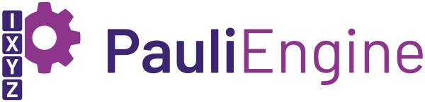

<p align="center">
  <picture>
    <source media="(prefers-color-scheme: dark)" srcset="docs/logo/pauliengine-lockup-paulis-reverse.svg">
    
  </picture>
</p>

# PauliEngine — Fast Arithmetic for Quantum Operators

PauliEngine is a header-only C++20 library with a Python frontend for
operators built from Pauli strings: single strings, sums of strings (qubit
Hamiltonians), and the symmetry-adapted Pauli cycles and Pauli orbits.
Coefficients are complex numbers or polynomials in named parameters. There are
no C++ dependencies.

- Algorithms: [arXiv:2601.02233](https://arxiv.org/abs/2601.02233)
- Pauli cycles and orbits: [arXiv:2604.16701](https://arxiv.org/abs/2604.16701)

> **Naming.** In Python a sum of Pauli strings is a `PauliStringSum`. The old
> names (`QubitHamiltonian`, `QubitHamiltonianComplex`, `to_qubit_hamiltonian()`,
> ...) remain as aliases, so existing code keeps working. In C++ the class is
> still `QubitHamiltonian<Coeff>`.

---

## Contents

- [Highlights](#highlights)
- [Installation](#installation)
- [Tutorials](#tutorials)
  1. [Pauli strings](#1-pauli-strings)
  2. [Pauli string sums: every way to build one](#2-pauli-string-sums-every-way-to-build-one)
  3. [Arithmetic, properties and transformations](#3-arithmetic-properties-and-transformations)
  4. [Symbolic coefficients](#4-symbolic-coefficients)
  5. [Pauli cycles](#5-pauli-cycles)
  6. [Pauli orbits](#6-pauli-orbits)
  7. [Mixing representations and inner products](#7-mixing-representations-and-inner-products)
  8. [Many qubits: sparse operators](#8-many-qubits-sparse-operators)
  9. [Lie algebras: unweighted strings](#9-lie-algebras-unweighted-strings)
  10. [Matrices and OpenFermion](#10-matrices-and-openfermion)
- [C++ usage](#c-usage)
- [Testing](#testing)
- [Citation](#citation)
- [Acknowledgments](#acknowledgments)

---

## Highlights

- **Binary symplectic form**: products, commutators and hashes of Pauli strings
  cost O(n / 64) words, and sums run on flat arrays with OpenMP.
- **Always compact**: every operation returns sums in which no two terms share an
  operator and zero terms are dropped, without a call to `simplify()`.
- **Symbolic coefficients**: PauliEngine's own polynomials, in canonical form
  (`a - a` is `0`), thread-safe and parallel like the numeric path, with `diff`,
  `subs` and complex symbols.
- **Symmetry-adapted bases**: Pauli cycles (translation invariant) and Pauli
  orbits (permutation invariant) multiply and commute without expanding into
  Pauli strings.
- **Many qubits**: low-weight operators on hundreds or thousands of qubits are
  stored sparse automatically, so their cost no longer grows with the number of
  qubits.
- **One arithmetic for everything**: `+`, `-`, `*`, `/`, `commutator` and
  `inner_product` work between all representations.
- **Interop**: OpenFermion `QubitOperator`, dense matrices both ways, and a
  Tequila-style API (`qubits`, `dagger`, `simplify`, `split`, `map_qubits`, ...).

---

## Installation

```bash
pip install pauliengine
```

Wheels are available for Linux (x86_64, aarch64), macOS (arm64) and Windows
(x86_64, arm64) on Python 3.10–3.13. To build from source you need a C++20
compiler (MSVC 19.3+, GCC 11+ or Clang 14+), CMake 3.20+ and Python 3.10–3.13:

```bash
pip install .          # or pip install -e . for development
```

OpenFermion and NumPy are optional; they are only needed for the functions that
take or return their objects.

---

## Tutorials

All examples start with

```python
import pauliengine as pe
```

### 1. Pauli strings

A Pauli string is a coefficient times a tensor product of `X`, `Y` and `Z` on
some qubits. `pe.PauliString` takes the operators in several forms:

```python
p = pe.PauliString(0.5, {0: "X", 2: "Z"})          # {qubit: Pauli}
p = pe.PauliString(0.5, "XIZ")                     # dense text, character i acts on qubit i
p = pe.PauliString(0.5, "X0 Z2")                   # sparse text
p = pe.PauliString((0.5, [("X", 0), ("Z", 2)]))    # OpenFermion style (coeff, [(Pauli, qubit)])
s = pe.PauliString("2*a", {1: "Y"})                # symbolic coefficient (section 4)

print(p)                 # 0.500000 + 0.000000i : X(0)Z(2)
p.qubits()               # [0, 2]
len(p)                   # 2, the weight
p.get_pauli_at_index(2)  # 'Z'
p.coeff                  # (0.5+0j)
```

Products carry the phase of the Pauli algebra; the commutator of two strings is
again a string (`2 * a * b` if they anti-commute, the zero string otherwise):

```python
x, y = pe.PauliString(1.0, {0: "X"}), pe.PauliString(1.0, {0: "Y"})
print(x * y)             # 0.000000 + 1.000000i : Z(0)
x.commutator(y)          # 2i Z(0)
x.anticommutes(y)        # True
x + y                    # a PauliStringSum
3 * x, x / 2, -x         # scaled strings
```

### 2. Pauli string sums: every way to build one

A `PauliStringSum` is a linear combination of Pauli strings. The factory
`pe.PauliStringSum` accepts all of the following, and the *content* of the input
decides which class you get:

```python
# a list of Pauli strings
H = pe.PauliStringSum([pe.PauliString(1.0, {0: "Z", 1: "Z"}), pe.PauliString(0.5, {0: "X"})])

# a list of (coefficient, operators) pairs; operators as dict, dense or sparse text
H = pe.PauliStringSum([(1.0, {0: "Z", 1: "Z"}), (0.5, "XI"), (0.5, "X1")])

# sums of strings
H = pe.PauliString(1.0, "ZZ") + pe.PauliString(0.5, "XI") + pe.PauliString(0.5, "IX")

# a symbolic coefficient anywhere makes the whole sum symbolic
S = pe.PauliStringSum([("a", {0: "X"}), (2.0, {1: "Z"})])

# a copy of an existing sum
H2 = pe.PauliStringSum(H)

# special sums and conversions
Z = pe.PauliStringSum.zero()                          # no terms
I = pe.PauliStringSum.unit()                          # the identity
M = pe.PauliStringSum.from_matrix([[1, 0], [0, -1]])  # Pauli decomposition: Z(0)
C = pe.PauliCycle(4, "XZII").to_pauli_string_sum()    # expand a cycle (section 5)
O = pe.PauliOrbit(4, 1, 1, 0).to_pauli_string_sum()   # expand an orbit (section 6)
# pe.PauliStringSum(openfermion_qubit_operator)       # section 10
```

Which class is built:

| Input | Class |
|---|---|
| numeric coefficients only | `PauliStringSumComplex` |
| at least one symbolic coefficient | `PauliStringSumSymbolic` |
| every string light on many qubits (section 8) | `SparsePauliStringSumComplex` / `...Symbolic` |
| strings without a coefficient (section 9) | `unweighted_PauliStringSum` |

You rarely need to know the class: `isinstance(x, pe.PauliStringSum)` is true for
every weighted sum, and `isinstance(x, pe.PauliString)` for every weighted string,
whichever class the factory chose.

```python
type(S).__name__                       # 'PauliStringSumSymbolic'
isinstance(S, pe.PauliStringSum)       # True
isinstance(H, pe.QubitHamiltonian)     # True, the old name still works
```

### 3. Arithmetic, properties and transformations

```python
H = pe.PauliStringSum([(1.0, {0: "Z", 1: "Z"}), (0.5, {0: "X"}), (0.5, {1: "X"})])
G = pe.PauliStringSum([(0.3, {0: "Y"})])

H + G, H - G, H * G, -H, 2j * H, H / 4    # sums are compacted after every step
H ** 3                                    # integer powers (h * h uses a square formula)
H.commutator(G)                           # [H, G]
H.targeted_commutator(G, pe.PauliString(1.0, {0: "X", 1: "Z"}))   # one coefficient of [H, G]

len(H)                                    # 3 terms
H.qubits(), H.n_qubits()                  # [0, 1], 2
H.is_hermitian(), H.is_all_z()            # True, False
H.contains(pe.PauliString(1.0, {0: "X"})) # 0.5: coefficient of X(0)
pe.PauliString(1.0, {0: "X"}) in H        # True

H.dagger(), H.conjugate(), H.transpose()
H.simplify(0.4)                           # drop terms with |coefficient| <= 0.4
herm, anti = (H + 1j * G).split()         # Hermitian and anti-Hermitian part
H.map_qubits({0: 5})                      # qubit 0 becomes qubit 5
H.paulistrings()                          # the terms as Pauli strings
H.to_dictionary()                         # [(coefficient, {qubit: Pauli}), ...]
```

### 4. Symbolic coefficients

A text coefficient such as `"a"`, `"2*a*b + 3"`, `"a**2 - b/4"` or `"(1 + 2*I)*c"`
is a polynomial in named symbols with complex coefficients (`I` is the imaginary
unit). Polynomials are canonical, so `"a - a"` is zero and equal polynomials
compare equal. Division is only possible by numbers.

```python
S = pe.PauliStringSum([("a", {0: "X"}), ("a*b", {1: "Z"})])

S.diff("a")                         # derivative of every coefficient
S.subs({"a": 0.5, "b": 2.0})        # values for symbols; the result stays symbolic
T = S.subs({"a": 0.5, "b": 2.0})
T.to_matrix()                       # numeric once no symbols are left
S * pe.PauliString(2.0, {0: "Y"})   # numeric and symbolic mix: the result is symbolic
```

`subs` also puts in polynomials, as text or as `pe.Expression`, mixed freely with
numbers. All symbols are replaced at once, so `{"a": "b", "b": "a"}` swaps them:

```python
S.subs({"a": "x + 1"})              # (x + 1) X(0) + (b + b*x) Z(1)
S.subs({"a": "2*x", "b": 0.5})      # 2*x X(0) + x Z(1)
S.subs({"a": "b", "b": "a"})        # b X(0) + a*b Z(1)
```

`pe.Expression` is the coefficient type itself:

```python
e = pe.Expression("a**2 - b/4")
str(e)                    # 'a**2 - 0.25*b'
e.diff("a")               # 2*a
e.subs({"a": 2, "b": 4})  # 3
e.free_symbols()          # ['a', 'b']
complex(pe.Expression("2 + 3*I"))   # (2+3j)
pe.PauliString(1.0, "XZ") * e       # a symbolic Pauli string
```

`dagger()` and `conjugate()` need not know whether a symbol is real or complex:
they turn `z` into `conjugate(z)`, a flag that `z` was conjugated. Whatever is put
in later, `subs` fills in the conjugated value (or polynomial) there, so the
result is always right:

```python
D = pe.PauliStringSum([("z", {0: "X"})]).dagger()   # conjugate(z) : X(0)
D.subs({"z": 1 + 2j})                                # (1 - 2*I) : X(0)
D.subs({"z": 0.5})                                   # 0.5 : X(0)
D.diff("z")                                          # 1 : X(0)
```

`diff("z")` differentiates `conjugate(z)` like `z`, which is right for real
parameters. Two declarations change this:

| Declaration | `conjugate(a)` | `diff("a")` of `conjugate(a)` |
|---|---|---|
| none (default) | the flag `conjugate(a)` | 1, like `a` |
| `pe.set_symbol_real("a")` | `a` itself, so `H.dagger() == H` for Hermitian `H` | 1 |
| `pe.set_symbol_complex("a")` | the flag `conjugate(a)` | 0 (Wirtinger: `a` and `conjugate(a)` independent) |

```python
pe.set_symbol_real("theta")
H = pe.PauliStringSum([("theta", {0: "X"}), ("theta**2", {1: "Z"})])
H.dagger() == H                                      # True
```

### 5. Pauli cycles

A Pauli cycle on `n` qubits is a base string together with all of its cyclic
rotations, `C(P) = c * sum_k R^k P`. Translation-invariant operators stay a
handful of cycles instead of `n` times as many strings.

```python
a = pe.PauliCycle(8, "XZIIIIII")            # base as dense text, coefficient 1
b = pe.PauliCycle(8, {0: "Y", 1: "Y"}, 0.5) # base as dict, with a coefficient
c = pe.PauliCycle(8, pe.PauliString(2.0, "ZIZ"))   # base and coefficient from a string
s = pe.PauliCycle(8, "XZ", "J")             # symbolic coefficient

a.commutator(b)                 # PauliCycleSum, without expanding the rotations
a * b                           # PauliCycleSum
a.period()                      # 8 distinct rotations
pe.PauliCycle(4, "ZIZI").period()   # 2
a.to_pauli_string_sum()         # all 8 rotations as a PauliStringSum

ising = pe.PauliCycleSum([pe.PauliCycle(8, "ZZ", 1.0), pe.PauliCycle(8, "X", 0.5)])
ising.commutator(ising * 2)     # sums merge cycles of the same rotation orbit
ising.contains(pe.PauliCycle(8, "IZZ"))   # (1+0j): rotations are the same cycle
```

### 6. Pauli orbits

A Pauli orbit `B(p, q, r)` on `n` qubits is the normalized sum of *all* strings
with `p` X-, `q` Y- and `r` Z-sites, `(i / N) * sum P`. Permutation-invariant
operators stay a few orbits, whatever the number of strings.

```python
o = pe.PauliOrbit(6, 1, 1, 0)       # every string with one X and one Y on 6 qubits
o.n_terms()                         # 30 strings
z = pe.PauliOrbit(6, 0, 0, 2)

o.commutator(z)                     # PauliOrbitSum, never expanded
o * z                               # PauliOrbitSum
2 * o                               # PauliOrbitSum (an orbit has no coefficient of its own)

H = pe.PauliOrbitSum(6, [(o, 1.0), (z, "g")])    # orbits with coefficients, here symbolic
H.commutator(H)
o.targeted_commutator(z, o)         # one structure constant of [o, z]
o.to_pauli_string_sum()             # the 30 strings, only for small orbits
```

Orbits are limited to 170 qubits (`pe.PauliOrbit.max_qubits`), since their
structure constants use `n!` in double precision.

### 7. Mixing representations and inner products

Every representation combines with every other one through `+`, `-`, `*`,
`commutator` and `inner_product`:

```python
c = pe.PauliCycle(6, "XZ")
o = pe.PauliOrbit(6, 1, 1, 0)
p = pe.PauliString(0.5, {0: "Y"})

c + c.commutator(c)       # stays a PauliCycleSum
o * o                     # stays a PauliOrbitSum
c * o                     # different families: a PauliStringSum
p.commutator(o)           # PauliStringSum
c * pe.Expression("k")    # a symbolic PauliCycle
```

Within the cycle family and the orbit family results stay compressed; any other
combination expands both operands into a `PauliStringSum` (symbolic as soon as
one operand is).

`inner_product` is the Hilbert-Schmidt inner product normalized so that Pauli
strings are orthonormal, `Tr(A^dagger B) / 2^n`. It is conjugate-linear in the
first argument and never expands orbits:

```python
o.inner_product(o)                                          # 1 / 30
pe.inner_product(pe.PauliCycle(4, "ZIZI", 1.5), pe.PauliString(1.0, {0: "Z", 2: "Z"}))   # 3
p.inner_product(p)                                          # 0.25
```

### 8. Many qubits: sparse operators

Strings with bit vectors take words up to their highest qubit, so a term of
weight 2 on qubit 4000 takes 126 words. When an operator spans at least 256
qubits and **every** string has weight at most 1/256 of that span, the factories
store only the non-identity sites instead. From there on products and
commutators cost the same for any number of qubits.

```python
chain = pe.PauliStringSum([(1.0, {j: "Z", j + 1: "Z"}) for j in range(4095)])
field = pe.PauliStringSum([(0.5, {j: "X"}) for j in range(4096)])
type(chain).__name__                    # 'SparsePauliStringSumComplex'

chain + field                           # sums stay sparse
chain.commutator(field)                 # products and commutators come back with bit vectors
chain.fits_sparse()                     # True
chain.to_dense()                        # the same operator with bit vectors

pe.get_sparse_threshold()               # {'min_qubits': 256.0, 'max_density': 0.00390625}
pe.set_sparse_threshold(min_qubits=float("inf"))   # never sparse
pe.set_sparse_threshold(min_qubits=256, max_density=1 / 256)   # back to the default
```

Sparse classes have the same methods as the ones with bit vectors (plus
`to_dense`, `fits_sparse` and, for strings, `sites`), compare equal to them and
combine with every other representation, so code does not need to know which one
it got. A single heavy string makes the whole sum use bit vectors.

### 9. Lie algebras: unweighted strings

`pe.PauliString` without a coefficient gives an unweighted string `i**k * P`, and
a `pe.PauliStringSum` of such strings is an ordered *set* of operators. Use them
only as basis elements of a Lie algebra; for linear combinations use weighted
strings.

```python
generators = [pe.PauliString(w, phase=1) for w in ("ZI", "IZ", "XX")]   # i * P
basis = pe.PauliStringSum(generators)
while True:                       # close under the Lie bracket
    size = len(basis)
    basis += basis.commutator(basis)
    if len(basis) == size:
        break
len(basis)                        # 6: the dimension of the dynamical Lie algebra
```

- `commutator` is the Lie bracket without its factor 2: `a * b` if the strings
  anti-commute, otherwise `None`, with the exact phase.
- A set holds every operator once and keeps the first phase seen, so `A + A == A`.
- Times a number or next to a weighted operator, an unweighted string counts with
  coefficient `i**k` and the result is weighted: `0.5 * basis` is a `PauliStringSum`.

### 10. Matrices and OpenFermion

```python
import numpy as np

H = pe.PauliStringSum([(1.0, {0: "Z", 1: "Z"}), (0.5, {0: "X"})])
M = np.array(H.to_matrix())                            # 4 x 4, qubits H acts on only
M_abs = np.array(H.to_matrix(ignore_unused_qubits=False))   # absolute qubit indices
pe.PauliStringSum.from_matrix(M_abs) == H              # True: Pauli decomposition
```

`to_matrix` and `split` need numeric coefficients, so call `subs` first on a
symbolic sum. With OpenFermion installed:

```python
from openfermion import QubitOperator

qop = 1.5 * QubitOperator("X0 Y1") + 0.5j * QubitOperator("Z2")
H = pe.PauliStringSum(qop)                 # or pe.from_openfermion(qop)
pe.PauliStringSum.to_openfermion(H) == qop # True
```

---

## C++ usage

The library is header-only under `include/pauliengine/`. `PauliString<Coeff>`,
`QubitHamiltonian<Coeff>` (Python: `PauliStringSum`), the cycle and orbit
classes and the sparse classes work for `Coeff = std::complex<double>` and
`Coeff = pauliengine::symbolic::Expression` (`Polynomial.h`).
`Arithmetic.h` adds `+`, `-`, `*`, `commutator(a, b)` and `inner_product(a, b)`
between all of them:

```cpp
#include <pauliengine/Arithmetic.h>
#include <iostream>

int main() {
    using C = std::complex<double>;
    PauliString<C> x(1.0, {{0, "X"}}), z(0.5, {{0, "Z"}, {1, "Z"}});
    QubitHamiltonian<C> h({x, z});
    std::cout << (h * h).to_string() << commutator(h, x).to_string();

    using pauliengine::symbolic::Expression;
    QubitHamiltonian<Expression> s({PauliString<Expression>(Expression("a"), {{0, "Y"}})});
    std::cout << commutator(s, h).diff("a").to_string();
}
```

Every operation of the Python API exists in C++ under the same name, except that
`to_pauli_string_sum` is `to_qubit_hamiltonian`, `subs` is `substitute` and
`PauliStringSum.from_matrix` is the free function `pauli_decomposition`
(`PauliDecomposition.h`). Compile with C++20 and, optionally, OpenMP with
`-DPAULIENGINE_HAS_OPENMP`.

---

## Testing

```bash
pip install pytest
pytest tests/
```

---


## Citation

If you use PauliEngine in academic work, please cite
[arXiv:2601.02233](https://arxiv.org/abs/2601.02233); for Pauli cycles and
orbits also [arXiv:2604.16701](https://arxiv.org/abs/2604.16701).


---

## Acknowledgments

PauliEngine is developed at the University of Augsburg. We thank our external contributors (that helped in the development of Release 1.0.0):

- **Craig Gidney** (Google Quantum AI): faster Pauli-string multiplication using Stim's bitwise phase counters (#1).
- **Ludmila Botelho** (Algorithmiq): build system, devcontainer, wheel workflow, and the Python bindings (#3, #4).
- **Roberto Di Remigio Eikås** (Algorithmiq): from-source SymEngine setup for the devcontainer.
- **Moritz Willmann** (Fraunhofer IPA): installation fixes for Windows and WSL (#2).
- **Konstantin Golovkin** and the [PauLie](https://github.com/QPauLie/PauLie) team: benchmarking and feedback on string construction and coefficient-free strings (#5).

We also thank Florian Krötz ([PauLIB](https://github.com/Flousen/PauLIB)) for discussions on high-performance Pauli arithmetic, and Philipp Greiner for his work on the Lie-closure routines.
